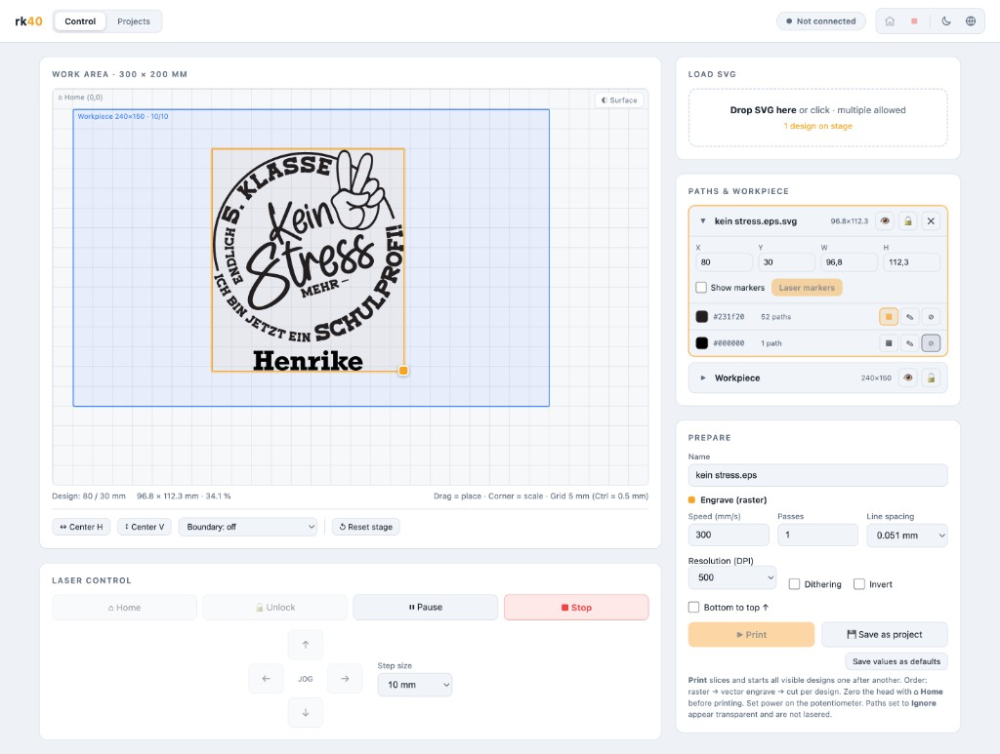

# rk40

[Deutsch](README.de.md)

> **Derived from [K40 Whisperer](https://www.scorchworks.com/K40whisperer/k40whisperer.html)**
> by Scorch (scorchworks.com). A Rust reimplementation of the protocol and
> control core — **not an official Scorch project**. See [NOTICE](NOTICE).

Single-user web server for driving a **K40 laser cutter** (M2 Nano board,
LHYMICRO-GL protocol), written in Rust.

One self-contained binary with no runtime dependencies: web server, SVG
slicer, USB driver, and UI are all built in. Runs on **macOS, Linux, and
Windows**.



## Features

- **Load & slice SVG** – SVGs are rendered directly (no Inkscape required)
  and translated into EGV data for the M2 Nano board.
- **Raster engraving** – Scanline engraving with selectable line spacing
  (0.025–0.1 mm), resolution, optional Floyd–Steinberg dithering, and
  inversion.
- **Vector engrave & vector cut** – Paths are flattened at high precision
  and run as cut lines.
- **Color mapping** – SVG colors are detected; per color you can choose
  raster engrave, vector engrave, cut, or ignore
  (defaults: red `#ff0000` = cut, blue `#0000ff` = vector engrave,
  everything else = raster — same as K40 Whisperer). A job combines all
  operations in order engrave → vector engrave → cut, with its own speed
  and pass count per operation.
- **Scaling** – by target size (width/height in mm), factor, or by dragging
  a corner handle on the bed.
- **Light/dark UI** – theme toggle in the header (follows the system
  preference initially) and a separate bed-background toggle — light by
  default so black SVGs stay visible. Both are remembered in the browser.
- **Print now or save as project** – “Print” slices and starts in one step;
  “Save as project” stores the computed job (`egv.bin`) in the project list
  so reprints do not need the SVG again. Projects can be downloaded as
  `.egv` (K40 Whisperer–compatible) and `.svg`, and reloaded onto the stage
  at any time.
- **Server-side working copy** – stage, SVG, position, and all parameters
  survive page reloads and server restarts; “Reset stage” clears them.
  Parameter defaults are editable in the UI and stored on the server.
- **Position markers & workpiece** – small corner markers of the design
  bounding box can be lasered separately (e.g. onto a fixture) for precise
  workpiece placement; the workpiece outline can be shown as a lockable
  rectangle on the bed.
- **Multi-pass without re-homing** – passes run back-to-back; the head does
  *not* return to home between passes.
- **Offline use** – prepare, save, and preview SVGs without a laser
  connected.
- **In-browser laser control** – home, unfreeze, e-stop, pause, jog,
  live progress (SSE), drag-to-place on the 300 × 200 mm bed.

## Installation (binary releases)

Pre-built binaries are published under
[Releases](https://github.com/corelgott/rk40/releases) when a version tag
is pushed (e.g. `v0.1.0`). Binary builds run **only on tags** matching
`v*`, not on every push.

```bash
git tag v0.1.0
git push origin v0.1.0
```

Artifacts per platform: Linux and Windows binaries, a macOS binary, and an
unsigned `rk40.app` (see below). Tags containing `rc` / `alpha` / `beta` /
`pre` are published as GitHub pre-releases.

## Building

Requires [Rust](https://rustup.rs) (stable). The USB library (libusb) is
compiled in (`vendored`); no system packages are needed — except on Linux,
where `pkg-config` / build tools are expected.

```bash
cargo build --release
./target/release/rk40 --port 8040
```

Then open <http://localhost:8040> in a browser.

| Option | Meaning | Default |
|---|---|---|
| `--port`, `-p` | HTTP port | `8040` |
| `--data-dir`, `-d` | Storage for saved jobs | `~/.rk40` |

### USB access

The K40 appears as USB device `1a86:5512` (CH341).

- **macOS**: works out of the box; no drivers needed.
- **Linux**: the `ch341` kernel driver is detached automatically.
  For access without root, add a udev rule:
  ```
  # /etc/udev/rules.d/99-k40.rules
  SUBSYSTEM=="usb", ATTRS{idVendor}=="1a86", ATTRS{idProduct}=="5512", MODE="0666"
  ```
- **Windows**: use [Zadig](https://zadig.akeo.ie) to install the
  *libusb-win32* or *WinUSB* driver for the device (same as K40 Whisperer).

### macOS: allowing the unsigned app

The release file `rk40-macos-*.app.zip` contains an unsigned `.app`
(no Apple Developer ID). Gatekeeper blocks the first launch — that is
expected.

1. Unzip the archive.
2. **Right-click** `rk40.app` → **Open** → confirm the dialog.
3. If needed: *System Settings* → *Privacy & Security* → “Open Anyway”.
4. Or clear the quarantine flag:
   ```bash
   xattr -cr rk40.app
   ```

The app starts the local server and opens the browser at
<http://localhost:8040>. Quit via the Dock (or Activity Monitor).

Build the bundle locally:

```bash
cargo build --release
./scripts/package-macos-app.sh
```

## Workflow

1. **Load an SVG** (drag & drop) and place it on the bed.
2. Choose mode, speed, passes, etc., then **Prepare & Save** — the job is
   sliced into the library.
3. **Connect** the laser and **Home** the head.
4. **Print** — placement is baked into the job; the head starts from home
   and returns afterward. The job can be repeated as often as you like.

> **Power note:** The M2 Nano cannot set laser power in software — use the
> K40’s potentiometer as usual.

## Reliability during a job

The K40 has a tiny buffer — if the USB stream stalls, the head stops mid-
job. rk40 mitigates that:

- **Sleep inhibition**: while a job runs, rk40 keeps the machine awake
  (macOS: `caffeinate`, Linux: `systemd-inhibit`). On Windows, disable sleep
  for the duration of the job.
- **USB reconnect**: on USB dropouts (common on K40s from PSU EMI), rk40
  reopens the device and continues — it gives up only after ~2 minutes.
- **Visible errors**: if a job still aborts, a red banner shows the reason;
  details also go to the server log (stderr).

If jobs keep failing mid-run: use a short, well-shielded USB cable with a
ferrite, avoid hubs, and ground the K40 properly — the usual fixes for
these machines.

## Architecture

```
src/
├── main.rs         Server start, CLI args
├── api.rs          REST API + SSE + embedded SPA
├── device.rs       USB driver (rusb): packets, CRC, status codes, job loop
├── egv.rs          EGV / LHYMICRO-GL encoder (port of egv.py)
├── laser_speed.rs  Speed codes (port of LaserSpeed.py, M2 board)
├── planner.rs      SVG → scanlines/polylines → EGV (resvg, dithering)
└── jobs.rs         Job store (meta.json, egv.bin, preview.png, source.svg)
static/index.html   Single-page app (vanilla JS, no build tools)
```

The protocol core is verified against the original: identical inputs produce
**byte-identical** EGV streams to K40 Whisperer’s `egv.py`
(see `examples/dump_egv.rs`); speed codes are tested against `LaserSpeed.py`
(`cargo test`).

## License

GPL-3.0-or-later — see [LICENSE](LICENSE) and [NOTICE](NOTICE).
Derived from K40 Whisperer, © Scorch (scorchworks.com).
